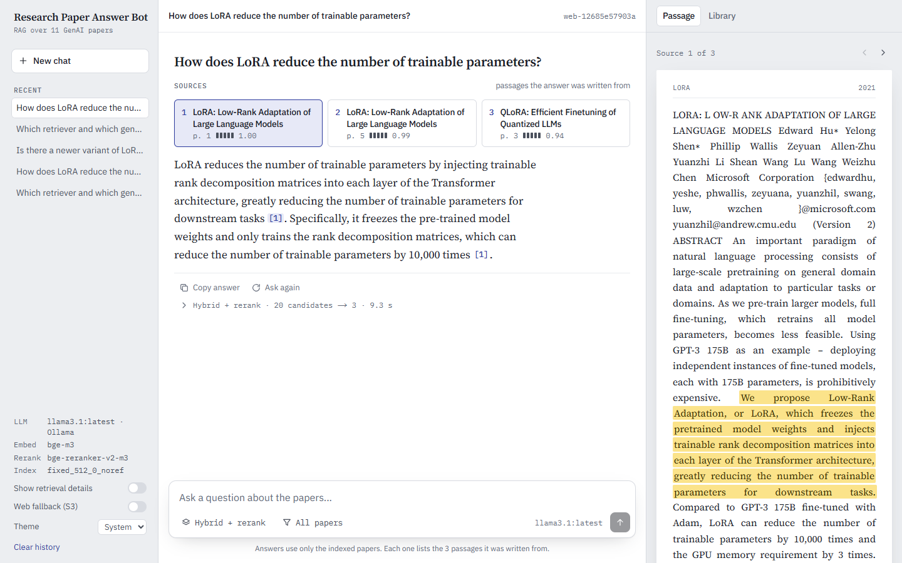
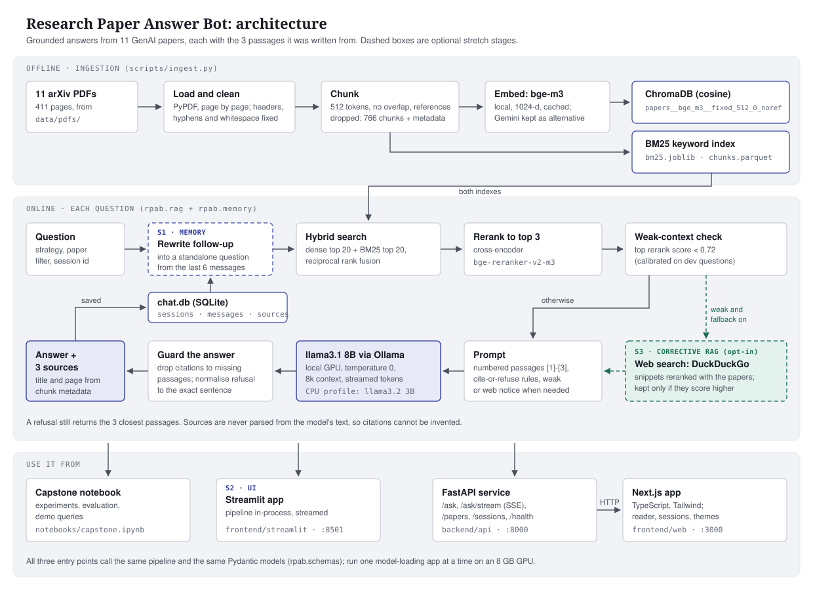

# Research Paper Answer Bot

A retrieval-augmented generation (RAG) system over 11 seminal Generative AI research papers.
Ask a question in plain language and get an answer written only from the papers, with the
3 supporting passages cited by paper title and page number. When the papers do not contain the
answer, the bot says "I don't know based on the provided papers." and still shows what it found.

Capstone project for the GenAI Pinnacle Plus program. Everything runs locally: no paid API keys.



## How it works



Each question goes through hybrid search (dense bge-m3 plus BM25, fused), a cross-encoder reranks
20 candidates down to 3, and llama3.1 8B answers from those 3 numbered passages only, citing them
as [1] to [3]. Sources are built from chunk metadata, never parsed from the model's text, so a
citation cannot point to a page that was not retrieved. A follow-up question is first rewritten
into a standalone one from the chat history (S1), and a weak match can optionally be topped up
with a web search (S3).

## Results

Held-out questions only (12 answerable, 2 out of scope; tuning used the separate dev set).
Details in notebook sections 6, 8 and 11.

| Measure | Result |
|---|---|
| Retrieval, hybrid + rerank | hit@3 1.000, hit@1 0.750, MRR 0.847, 0.56 s per question |
| Retrieval, dense baseline | hit@3 0.833, MRR 0.736 |
| Answers (manual scores, 1-5) | relevance 4.93, accuracy 4.36, groundedness 4.64 |
| Hallucination | 2 of 14 answers contain an unsupported claim |
| Refusals | both out-of-scope questions refused (5 of 5 on all splits); no answerable question refused |
| Latency (RTX 4060) | first word after 1.9 s, full answer in 5.0 s (medians) |

## Stack

| Part | Choice |
|---|---|
| Orchestration | LangChain (LCEL) |
| LLM | `llama3.1:8b` via Ollama (local) |
| Embeddings compared | `BAAI/bge-m3` (open-source) vs `gemini-embedding-001` (commercial, free tier) |
| Vector store | ChromaDB (persistent, cosine) |
| Keyword search | `rank_bm25` |
| Reranker | `BAAI/bge-reranker-v2-m3` |
| Apps | Streamlit, and Next.js over FastAPI |
| Web fallback (optional) | DuckDuckGo search via `ddgs`, no API key |

## Layout

```text
backend/
  rpab/          Python package with all pipeline logic (config, loading, chunking, retrieval,
                 RAG chain, memory, web fallback, evaluation)
  api/           FastAPI service used by the Next.js app
  scripts/       Command-line entry points (setup, environment check, ingestion)
  notebooks/     capstone.ipynb, the main deliverable; imports from rpab
  tests/         pytest suite for the API, memory and web fallback (no models needed)
  data/pdfs/     Source PDFs (not committed) and manifest.json
  data/eval/     Labelled evaluation questions and the manual answer scores
  artifacts/     Generated indexes, caches and logs (not committed, except experiments.csv)
frontend/
  streamlit/     Streamlit app
  web/           Next.js app
slides/          Architecture diagram, app screenshots and the final presentation
```

## Setup

Requires Python 3.12 and [Ollama](https://ollama.com). An NVIDIA GPU with at least 6 GB is
recommended but not required. From the repository root:

```powershell
setup.bat            # Windows
./setup.sh           # macOS / Linux
```

The script detects the hardware, creates `backend/.venv`, installs the requirements with the
matching PyTorch build (CUDA or CPU), checks Ollama and pulls the model, asks the runtime
choices, reuses or builds the index, and finishes with `scripts/check_env.py`. Useful options:

| Command | Effect |
|---|---|
| `setup.bat --yes` | Accept every default without questions |
| `setup.bat --yes --embedding open` | Fully local: bge-m3 embeddings, no API key, nothing sent to Google |
| `setup.bat --dry-run` | Show what would happen without changing anything |
| `setup.bat --help` | All options |

Choices are saved as `RPAB_*` variables in `backend/.env.local` (git-ignored); rerun setup to
change them. Only machine-dependent choices are offered. Experiment results such as the
chunking stay fixed in `backend/rpab/config.py`.

### Hardware profiles

Timings measured on an i7-12700H laptop with an RTX 4060 (8 GB), with the GPU hidden for the
CPU column. A 200-token answer from a prompt of 3 passages (about 1,250 tokens):

| | GPU profile | CPU profile |
|---|---|---|
| LLM | `llama3.1:8b` | `llama3.2:3b` (reduced quality) |
| Reranker | on (0.4 s per question) | off (it would add 22 s per question) |
| First word / full answer | 3.2 s / 7.6 s | 29 s / 42 s |
| Building the index | 11 s (bge-m3) | about 15 min (bge-m3 or Gemini free tier) |

Without a GPU, Gemini embeddings are the faster option because no local embedding model has to
run. The submission zip ships a prebuilt index in `backend/artifacts/`, which setup reuses.

### Manual setup

```powershell
cd backend
uv venv .venv --python 3.12
uv pip install --python .venv\Scripts\python.exe -r requirements.txt
copy .env.example .env.local    # then add GOOGLE_API_KEY (free from Google AI Studio)
ollama pull llama3.1
.venv\Scripts\python scripts\check_env.py
```

`check_env.py` confirms the imports, the GPU, the Ollama model (including the 8k context
window) and the Gemini key.

## Building the knowledge base

Put the paper PDFs in `backend/data/pdfs/`. Each file name must contain its arXiv id
(e.g. `LoRA - arXiv 2106.09685.pdf`) and the id must be listed in `backend/data/papers.json`.

```powershell
cd backend
.venv\Scripts\python scripts\ingest.py
```

This runs three stages: `load` (read and clean every page, write `data/pdfs/manifest.json`
and `artifacts/pages.parquet`, print a quality report), `chunk` (write the canonical
`artifacts/chunks.parquet`) and `index` (embed the chunks and build one Chroma collection
per embedding model under `artifacts/chroma/`). Stages can be run on their own, and
`--models open` indexes with the local model only:

```powershell
.venv\Scripts\python scripts\ingest.py chunk index --models open
```

## Notebook

`backend/notebooks/capstone.ipynb` is the main deliverable. It imports everything from `rpab`,
so the apps and the notebook run the same code. Its sections follow the brief: setup, data
loading and inspection, chunking experiments, embedding comparison, the vector database,
retrieval strategies, the RAG pipeline, evaluation and failure analysis, the stretch goals, the
final demo, and the experiment summary. Each section opens with its intent and closes with
observations and the decision taken.

Slow or networked experiments (the chunking grid, embedding the corpus with both models, the
strategy sweeps, answer generation and judging, the S1 and S3 runs) are saved in
`backend/artifacts/` and reloaded, so "Restart and run all" takes a few minutes. Set
`RUN_EXPERIMENTS = True` in the first code cell to recompute them; the Gemini parts need a
`GOOGLE_API_KEY` and are skipped without one. The final demo (section 10) always runs live.

## Rebuilding `backend/artifacts/`

The submission zip includes the prebuilt index. Everything under `backend/artifacts/` can be
recreated from the PDFs:

| File | Made by | Rebuild with |
|---|---|---|
| `pages.parquet`, `chunks.parquet` | ingestion: load, clean, chunk | `scripts/ingest.py load chunk` |
| `chroma/`, `embeddings_cache/` | ingestion: embed and index | `scripts/ingest.py index` (`--models open` for local only) |
| `bm25.joblib` | first retrieval, from `chunks.parquet` | rebuilt automatically when missing |
| `experiments.csv`, `*_per_question.parquet`, `chunk_grid/` | notebook experiments | `RUN_EXPERIMENTS = True` |
| `answers/` | notebook section 8 (answers and judge scores) | `RUN_EXPERIMENTS = True` |
| `multi_query_*cache.json`, `s1_*.json`, `s3_crag_demo.json` | notebook and app runs | delete them, or `RUN_EXPERIMENTS = True` |
| `chat.db` | the apps' saved chats | delete it to clear every chat |

## Stretch goals

**S1, conversational memory.** A request with a `session_id` (8-64 letters, digits, `-` or `_`,
chosen by the client, one per browser tab) is part of a conversation. The first question creates
the session, and each follow-up is rewritten by the chat model into a standalone question from the
last 6 messages before retrieval, so "What data type does it introduce?" searches for "What data
type does QLoRA introduce?". The rewritten question is returned as `rewritten_question` and shown as
"Searched as" in both apps. The rewriter sees the earlier questions and, in full, the most recent
question and answer, so "it" is read against the latest topic rather than an older one. History is
stored in `backend/artifacts/chat.db` (SQLite). Without a `session_id`, each question stands alone. Known limit: an elliptical follow-up such as "And the
big one?" can lose its qualifier (notebook section 9.1).

**S2, user interface.** The Streamlit app and the Next.js app below.

**S3, corrective RAG with a web fallback.** Off by default; both apps have a "Web fallback (S3)" switch,
and the API takes `"web_fallback": true`. When it is on and the best paper passage scores below
the calibrated weak-context threshold, the question is also sent to DuckDuckGo. The reranker scores
the web snippets against the question together with the paper passages and the best three are
kept, so a web result is used only when it beats the papers. Web sources are marked WEB, show their
address instead of a page, and the answer carries a note saying why the web was searched
(`web_note`). If the search fails, the answer uses the papers alone and says so. With the switch
on, the question leaves the machine; the apps say so next to the switch.

## Streamlit app

The Streamlit app answers in the same process, with no API needed. Start Ollama, then:

```powershell
cd frontend\streamlit
..\..\backend\.venv\Scripts\streamlit run app.py
```

It opens at `http://localhost:8501`. The page appears at once and the models load in the
background (about 20 s on the GPU, once per server). The layout follows the design mockup:
chats and settings on the left, the conversation in the middle, and a reader on the right that
shows a cited passage on its page (with the sentence the answer drew on highlighted) or the
paper library, whose checkboxes limit the search to chosen papers. Citation markers such as [1]
jump to their source card; clicking a card opens it in the reader. "Show retrieval details"
adds the query used, the weak-context flag and chunk scores to every answer. Chats are saved
in `backend/artifacts/chat.db`, so follow-up questions use the conversation (see Memory below).

Run either the Streamlit app or the API, not both: each loads the embedding model and the
reranker onto the GPU.

## Web app

The Next.js app (`frontend/web`) runs over the API. Start Ollama and the API (see below), then:

```powershell
cd frontend\web
npm install
npm run dev
```

It opens at `http://localhost:3000` with the same three panes as the Streamlit app, and adds
answers streamed word by word, citation chips that open their passage and preview it on hover,
copy buttons, a link to the cited page on arXiv, saved chats that survive a page reload, and a
light, dark or system theme. Below 1180 px the reader becomes a drawer, below 760 px the chats
and settings do too. If the API is not running, the page says how to start it and connects by
itself once it is up.

## API

The FastAPI service serves the Next.js app. Start Ollama first, then from `backend/`:

```powershell
.venv\Scripts\uvicorn api.main:app --port 8000
```

The server answers at once and loads the models in the background (about 20 s on the GPU);
`/health` reports `loading` until they are ready. Interactive docs are at
`http://localhost:8000/docs`.

| Endpoint | Purpose |
|---|---|
| `GET /health` | Pipeline state, Ollama and model availability, active models and strategies |
| `GET /papers` | The ingested papers with ids for the paper filter |
| `POST /ask` | One answer as JSON (`AskRequest` in, `AskResponse` out) |
| `POST /ask/stream` | The same answer as Server-Sent Events: `rewrite` (with a session), `sources`, `token` pieces, then `done` (or `error`) |
| `GET /sessions` | Saved chats, most recent first |
| `GET /sessions/{id}` | One chat with its messages and their sources |
| `DELETE /sessions/{id}` | Clear history: deletes the chat, its messages and sources |

Errors come back as `{"error": {"code": ..., "message": ...}}` with a message a user can act on,
for example `ollama_unavailable`, `model_missing`, `index_not_built` or `warming_up`. The API
handles one question at a time because the models share one GPU.

Tests run without models or Ollama: `.venv\Scripts\python -m pytest`.

## Demo script

The live demo follows doc 03 of the plan and was rehearsed end to end in the Next.js app (all steps
behaved as scripted; 5-8 s per answer on the RTX 4060). Each step has a fallback screenshot in
`slides/screenshots/`, taken at 125 % zoom as on a projector.

Before the audience watches: start Ollama, then the API and the web app, and ask one warm-up
question. The first answer after the models load takes about 10 s; later ones take 5-8 s.

| Step | Ask or show | Fallback |
|---|---|---|
| 1 | The architecture diagram (`slides/architecture.svg`); name each component | |
| 2 | Factual lookup: "Which retriever and which generator does the RAG model combine?" Open a source card | `02-lookup.png`, `02b-lookup-reader.png` |
| 3 | Method detail: "How are the LoRA matrices A and B initialised, and why?" Point out the page numbers | `03-method.png` |
| 4 | Comparison: "How do LoRA and QLoRA differ in how they keep the frozen pretrained weights?" | `04-comparison.png` |
| 5 | Follow-up (S1): "What data type does it use for the frozen weights?" Point at "Searched as" | `05-follow-up.png` |
| 6 | Out of scope: "How does Mamba's selective state space model replace attention?" The bot refuses and shows the closest passages | `06-refusal.png` |
| 7 | Optional: turn on "Web fallback (S3)" and ask "Is there a newer variant of LoRA that also adapts weight magnitude?" | `07-web-fallback.png` |
| 8 | The experiment summary (notebook section 11): why bge-m3 and hybrid + rerank | |

Ask the follow-up (step 5) straight after the comparison. In the rehearsal, asking it after the
out-of-scope question made "it" refer to Mamba, which the bot then refused. The Streamlit app
(`08-streamlit.png`) and dark mode (`09-dark.png`) have screenshots too.
